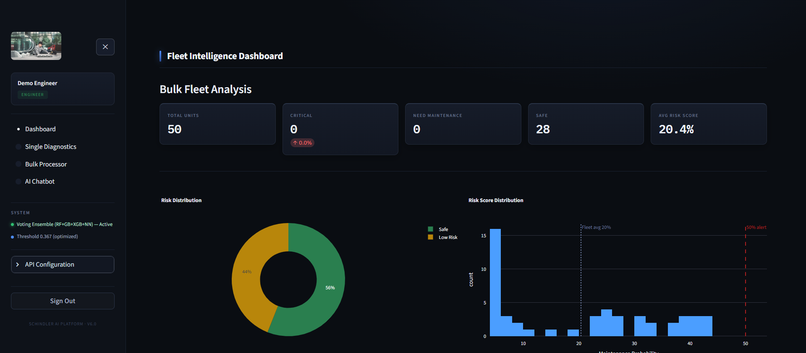

<div align="center">


# Schindler AI Maintenance Intelligence Platform

**Predictive maintenance for elevator fleets — a soft-voting ensemble of four ML/DL models, wrapped in a full operational web platform.**

[](https://www.python.org/)
[](https://streamlit.io/)
[](https://tensorflow.org/)
[](https://scikit-learn.org/)

[Dashboard](#-dashboard) · [Features](#-key-capabilities) · [Architecture](#-architecture) · [Quick Start](#-quick-start) · [Project Structure](#-project-structure)



*Fleet Intelligence Dashboard after a bulk analysis run — risk tiers, score distribution, and unit rankings.*

</div>

---

## Overview

Elevator fleets fail in expensive ways: door mechanisms, safety circuits, and drive components degrade between inspections, and maintenance is usually scheduled by calendar rather than by condition.

The **Schindler AI Maintenance Intelligence Platform** predicts maintenance needs from technician inspection checklists using a **soft-voting ensemble** (Random Forest + Gradient Boosting + XGBoost + a Keras neural network) trained on **23,617 real inspection records × 49 features** (46 safety checklist items + 3 engineered features). The application turns those predictions into an operational workflow: role-based access, bulk fleet analysis with unit-level risk ranking, single-unit diagnostics, executive PDF/Excel reporting, and **ARIA** — an LLM assistant that reasons over the live fleet data.

## Key Capabilities

| Area | What is implemented |
|---|---|
| **Ensemble prediction** | Soft-voting probabilities from RF + GB + XGB + NN; optimized decision threshold loaded from `best_threshold.pkl` |
| **Bulk fleet processor** | Upload an inspection workbook → automatic unit numbering, per-unit risk tier, threshold-based maintenance flags |
| **Single diagnostics** | Interactive technician checklist → instant risk score with gauge and severity-based recommendation |
| **Fleet dashboard** | Risk distribution, score histogram with fleet-average marker, top-10 highest-risk units, full unit risk map |
| **Reporting** | Executive PDF report and Excel export of all results |
| **ARIA assistant** | Groq-hosted LLM (Llama 3.3 70B) with strict access to the live fleet context — unit names, scores, tier counts |
| **Multi-user platform** | SQLite-backed auth (admin + up to 15 engineers), activity logging, per-engineer upload history, admin analytics |

## Architecture

```
Inspection checklist (.xlsx template)
            │
            ▼
┌─────────────────────────────┐
│  Ingestion & encoding       │  column sanitization, yes/no mapping,
│  (app.py · encode_upload)   │  engineered features (missing_count,
└─────────────┬───────────────┘  risk_density, safety_score)
              ▼
┌─────────────────────────────┐
│  Soft-voting ensemble       │  RF + GB + XGB (scikit-learn/xgboost)
│  (ElevatorRiskModel)        │  + Keras neural net on scaled features
└─────────────┬───────────────┘  mean of predicted probabilities
              ▼
┌─────────────────────────────┐
│  Risk tiering & actions     │  Safe / Low / Medium / Critical tiers,
│  (prob_to_risk + threshold) │  maintenance flags, PDF/Excel exports
└─────────────┬───────────────┘
              ▼
┌─────────────────────────────┐
│  Operational layer          │  Streamlit UI · SQLite (users, sessions,
│  (app.py + SQLite)          │  activity) · ARIA assistant (Groq API)
└─────────────────────────────┘
```

Model training lives in [`schindler_model_training.ipynb`](schindler_model_training.ipynb), which produces the artifacts loaded at runtime.

## Quick Start

**Requirements:** Python 3.10–3.12 (a virtual environment is recommended).

```bash
# 1) Clone and enter the project
git clone https://github.com/Youssef-Al-eng/Schindler-AI-Maintenance-Intelligence-Platform.git
cd Schindler-AI-Maintenance-Intelligence-Platform

# 2) Create a virtual environment and install dependencies
python -m venv venv
venv\Scripts\activate            # Windows  (use venv/bin/activate on Linux/macOS)
pip install -r requirements.txt

# 3) (Optional) enable the ARIA assistant
copy .env.example .env           # then put your Groq API key inside
                                 # get a free key at https://console.groq.com

# 4) Run
streamlit run app.py
```

The app opens at `http://localhost:8501`. Sign in with the demo admin account (**admin / admin2026**) or register an engineer account from the login screen.

> **Model artifacts:** the trained models (`*.pkl`, `*.keras`) are not committed — they are produced by running the training notebook. `model_metadata.json` documents the training configuration.

## Configuration

| Variable | Required | Purpose |
|---|---|---|
| `GROQ_API_KEY` | No | Enables the ARIA assistant. Can also be entered at runtime in the sidebar (API Configuration). |

Streamlit server/theme settings live in [`.streamlit/config.toml`](.streamlit/config.toml).

## Usage

1. **Bulk Processor** — download the inspection template, fill it with technician checklist responses (Yes/No), upload, and process. Every unit gets a name (`Unit 1 … Unit N`), a risk tier, and a maintenance flag based on the alert threshold.
2. **Dashboard** — auto-populates from the latest bulk run or single diagnostic.
3. **Single Diagnostics** — toggle checklist items for one unit and run an instant diagnostic.
4. **AI Chatbot (ARIA)** — ask for fleet health summaries, prioritized maintenance schedules, or executive summaries; answers cite actual unit names and scores.
5. **Admin Panel** *(admin only)* — platform-wide statistics, per-engineer deep dives, upload history inspection, and activity logs.

## Model Training & Evaluation

- Training pipeline and experiments: `schindler_model_training.ipynb`
- Dataset: `maintenance_dataset.xlsx` (23,617 inspection records; not committed — see the notebook for preprocessing)
- Artifacts produced by the notebook: `random_forest_model.pkl`, `gradient_boosting_model.pkl`, `xgboost_model.pkl`, `maintenance_model_v2.keras`, `scaler_v2.pkl`, `features_v2.pkl`, `best_threshold.pkl`
- Sample inspection workbooks for testing the bulk processor are in [`test/`](test/)

**Limitations (honest scope):** probabilities are tiered by fixed bands (Safe < 25% ≤ Low < 50% ≤ Medium < 75% ≤ Critical); the checklist inputs are binary; no remaining-useful-life estimation; evaluation metrics from the notebook should be re-validated on new fleets before operational use.

## Project Structure

```
├── app.py                          # Streamlit application (UI, auth, platform logic)
├── schindler_model_training.ipynb  # Model training & evaluation
├── requirements.txt
├── .streamlit/config.toml          # Server + theme configuration
├── .env.example                    # Environment variable template
├── Dockerfile / docker-compose.yml # Containerized deployment
├── test/                           # Sample inspection workbooks
├── screenshots/                    # Application screenshots
└── *.pkl / *.keras                 # Trained artifacts (generated by the notebook, gitignored)
```

## Roadmap

- [ ] Persist fleet results with versioning and diffing between inspections
- [ ] Remaining-useful-life estimation when failure-time labels become available
- [ ] Role-based REST API for integration with CMMS systems
- [ ] Automated retraining pipeline from registered inspection data

---

*Built as an applied machine-learning engineering project. Not affiliated with or endorsed by Schindler Group.*
